# dsh-plugin-sidebar-polish

去掉 DSH 左侧栏的**顶部品牌行**，让工作区/会话列表整体向上补位；
把**「新会话」按钮**改画成与它下面那组全局面板行（插件 / Skill-MCP / 自动化任务 / 乔木 RSS）
**同款的列表行**（此前这个按钮被整条隐藏，现在回来了：`新会话` 就是这份列表的第一行）；
把**面板行 / 工作区行 / 会话行**的 pill 与文字对齐到同一条线；
并给**无状态（idle）的会话行**左侧补一个与官方彩色状态点同尺寸的灰色圆点
（官方只在运行 / 待审批 / 刚完成时画点，无状态行留空）。

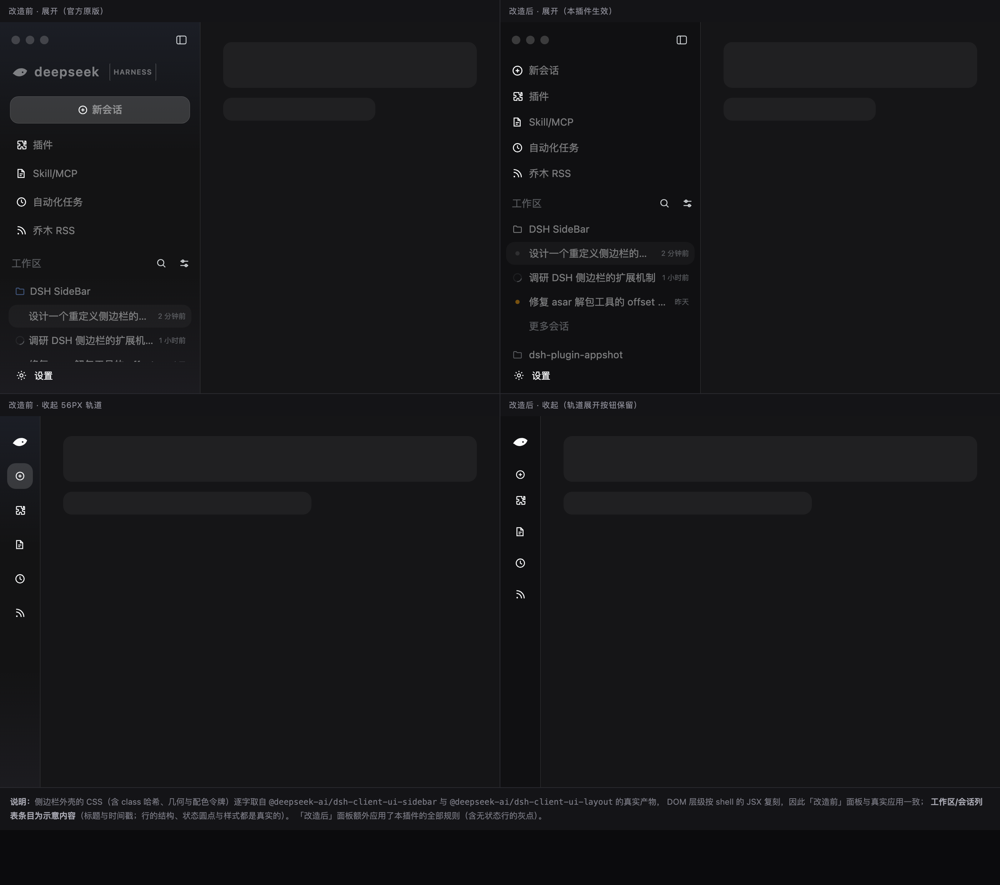

「新会话」按钮改造前后（上排静止、下排 hover）：

<p align="center">
  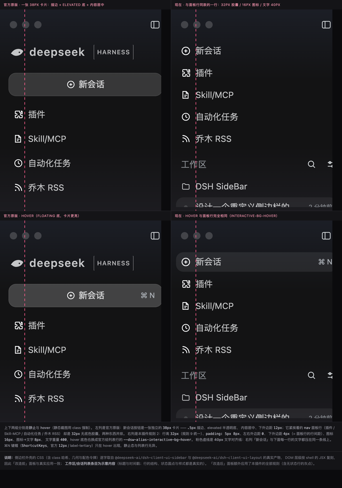
</p>

| | 官方原版 | 现在 |
|---|---|---|
| 顶部品牌行（鲸鱼 + deepseek HARNESS） | 有 | **移除** |
| 「新会话」按钮 | 有（38px 独立卡片：0.5px 描边 + elevated 半透明底 + 内容居中 + 下外边距 12px） | **保留，改画成面板行同款的一行**（32px 胶囊 / 16px 图标 / 图标→文字 8px / 文字 40px / 下外边距 4px / 无描边无底色） |
| 折叠开关（面板图标） | 展开态在侧栏最右（x = 240..268）、收起态在红绿灯右侧（x = 88..116），两态之间横跳 152px | **两态都钉在红绿灯右侧**（x = 88..116） |
| 列表位置 | 从第 ~110px 开始 | **直接顶到顶部** |
| 面板 pill 左右边距 | 14px | **8px**（与列表 pill 对齐） |
| 侧边栏左右内边距 | 12px | **8px** |
| 图标→文字间距（面板 / 工作区 / 会话） | 8 / 6 / 4px | **8 / 8 / 8px** |
| 「工作区」区段标题 x | 16px | **16px**（与图标同线） |
| 行高（面板 / 工作区 / 会话 / 更多会话） | 36 / 34 / 32 / 28px | **全部 32px**（含新会话行与「工作区」标题行） |
| 工作区与工作区之间 | 4px（组内行距的 2 倍） | **8px**（组内行距的 4 倍，分组一眼可辨） |
| 侧边栏底色（暗色） | 基色 #1b1b1c + 顶部淡蓝/底部淡紫渐变 | **基色 #151517（= 对话区）+ 去掉渐变**，50% 半透明保留 |
| 侧边栏底色（亮色） | 基色 #f9fafb，40% 不透明 | **基色 #ffffff（= 对话区）+ 不透明度 90%**，渐变去掉；实测 rgb(227,227,228) → rgb(248,248,250)（对话区 255,255,255） |
| 激活工作区的文件夹图标 | 蓝色强调 `rgb(122,170,255)` | **与行文字同色 `rgb(249,250,251)`** |
| 无状态（idle）会话行的左侧 | 空的（只有运行/待审批/刚完成才有圆点） | **补一个 6px 灰点**（官方 `idle` 状态色，与彩色点同尺寸同心） |
| 文字左对齐线（新会话 / 面板 / 工作区 / 会话） | 居中 / 46 / 42 / 40px | **40 / 40 / 40 / 40px** |
| 设置行（头像 + 名字）右侧 | 空的（整行本身就是账号菜单的触发按钮） | **补一个齿轮入口**：真实按钮、**自己的热区**、点击**直接打开设置面板**；盒子与「新建工作区」按钮完全重合（28×28，列宽 − 8px 那条线） |
| 工作区/会话列表、设置行、面板入口 | 保留 | 保留（原样） |
| 收起后的 56px 轨道展开按钮 | 有 | **保留** |
| 「展开其余 N 个会话」按钮 | 28px 高 / 12px 字 / hover 无底色 / 文案「展开其余 N 个会话」 | **32px 高 / 14px 字 / hover 同款胶囊 / 文案「更多会话」** |

预览页 `preview/compare.html` 由 `tools/build-preview.mjs` 在本地生成（**不随仓库分发**：页面内联了
DSH 官方样式表，生成方式见「自检」一节的第 0 步），生成后可直接在浏览器打开；
细粒度对齐见 [`preview/align.png`](preview/align.png)，新会话行见 [`preview/new-session.png`](preview/new-session.png)。
图中侧边栏外壳的 CSS 与 DOM 结构取自真实包，会话条目为示意内容。

---

## 安装

插件目录就是本目录。两种装法**二选一**，不要同时启用（会插入两行同名插件）：

```bash
# 本地目录（本仓库 clone 下来之后）
dsh plugin --profile desktop add "link:$PWD"

# 或直接从 GitHub
dsh plugin --profile desktop add "github:daoyu1993-lab/dsh-plugin-sidebar-polish"
```

它会把这个包加进 profile 的 `dependencies` 与 `dsh.profile.bundles`，并在 `node_modules/` 下
建一个指向本目录的**软链接**（登记的是 `link:` 依赖，`pnpm install` 不会把它清掉），
所以在这里改 `client.js` 会被热更新直接读到。应用运行中也能安装。

```jsonc
// ~/.dsh/profiles/desktop/package.json
"dependencies": {
  "dsh-plugin-sidebar-polish": "link:<本目录的绝对路径>"
},
"dsh": { "profile": { "bundles": [ ..., "dsh-plugin-sidebar-polish" ] } }
```

**验证装载点**：

```bash
dsh --profile desktop --dump-config | grep sidebar-polish
```

在本机（macOS 桌面版）实测核实：

- 运行中应用的**实时模块图**里包含本插件（`/plugins/events` SSE 的 `graph` 事件）；
- 客户端产物可下发：`/plugins/??dsh-plugin-sidebar-polish/client.js&rev=…` 返回 200，内容与本目录文件一致；
- 安装后没有产生新的崩溃日志。

> **页面需要刷新一次（⌘R）才能看到效果** —— 当前页面是在插件加入之前加载的。

### 卸载 / 回滚

```bash
dsh plugin --profile desktop remove dsh-plugin-sidebar-polish   # 需完全退出 App
```
或直接编辑 `~/.dsh/profiles/desktop/package.json`：从 `dependencies` 与
`dsh.profile.bundles` 里各删掉一行，重启应用。插件本身不改任何官方文件，
删掉之后界面立即回到原样；样式表由 `ctx.effect` 管理，插件卸载时会自动移除，不会残留。

---

## 实现方式：为什么是「一个样式表」而不是「一个组件」

左侧栏的外壳（品牌行、新会话按钮、折叠行为）由官方包 `@deepseek-ai/dsh-client-ui-sidebar` 渲染。
DSH 的槽位系统里有两条硬规则（已实测）：

1. **声明即认领**：只有声明了某个子槽的注册者才能渲染它；
2. **遮蔽者不能重复声明别人的子槽**（会抛 `slot "..." is already declared`）。

所以想「改外壳」只有两条路：

- **接管整个 `sidebar` 座位** → 会连同它声明的 7 个子座位一起失效（会话树、设置行、插件入口……全都要自己重写），除非先把官方外壳从组合里禁用掉，再自己声明同一套座位。
- **只加样式** → 外壳、座位、占用者全部保持原样，只是视觉上隐藏品牌行、并把「新会话」按钮重画一遍。

本插件整体上是第二条：**样式表打底，零构建，只在自己真正需要行为的地方才碰槽位**。
13 条规则全是纯 CSS，最坏情况只是「选择器失效 → 品牌行回来了、新会话按钮变回官方那张卡片」，
永远不会把侧边栏弄坏。

只有一处例外 —— **规则 14 的设置入口是真实的组件**：它要的不只是「看起来像一个入口」，
而是「点它直接开设置，而不是弹账号菜单」，还要和旁边的账号行**分成两个热区**。
伪元素做不到这两件事（它只能继承所在按钮的行为），所以那里注册了一个真正的
`<button>` 到官方外壳的 `sidebar.footer.action` 座位，由 CSS 排到设置行右端
（见 [规则 14](#14-设置行右侧的设置入口真实按钮)）。这一段是本插件唯一的 JS 逻辑。

## 选择器为什么这么写

DSH 的 class 名是 **CSS Modules 哈希**（`_3WPZCG_logoRow`），每次构建都会变，**不能用来写皮肤**。
这里只用两种跨版本稳定的锚点：

```css
/* 1. 顶部品牌行：只在「渲染了展开态品牌标识」时命中 */
[data-slot="sidebar"] > div > div[data-window-drag]:has([data-slot="sidebar.brand.name"]) {
  display: none !important;
}
/* 2. 新会话按钮：sidebar 根容器唯一的直接子 <button>，
      保留但改画成 nav 里 .panelRow 的同款（见下） */
[data-slot="sidebar"] > div > button {
  height: 32px;
  min-height: 32px;
  margin: 0 0 4px;            /* 左右 0 与面板行同边距；4px = 面板行行距 */
  padding: 5px 8px;
  border: none;
  border-radius: var(--dsw-radius-md);
  background: transparent !important;
  color: var(--dsw-alias-label-primary);
  font-weight: 400;
}
[data-slot="sidebar"] > div > button:hover {
  background: var(--dsw-alias-interactive-bg-hover) !important;
}
[data-slot="sidebar"] > div > button:focus-visible {
  outline: var(--dsw-focus-ring-width) solid var(--dsw-focus-ring-color, var(--dsw-alias-state-business-primary));
  outline-offset: -2px;
}
/* 内容左对齐 + 图标 16px：:has(> span) 只在宽态成立（收起态不渲染文字 span） */
[data-slot="sidebar"] > div > button > span:first-child > span:has(> span) {
  justify-content: flex-start;
  width: auto;
  gap: 8px;
}
[data-slot="sidebar"] > div > button > span:first-child > span:has(> span) > svg {
  width: 16px;
  height: 16px;
}
/* 2b. 折叠开关（面板图标）：展开态也钉到官方浮层的落点（红绿灯右侧）。
       全屏必须排除 —— 那时没有红绿灯，浮层与 topStrip 本来就都在 left:12px。 */
html[data-platform="darwin"]:not([data-fullscreen]) [data-slot="sidebar"] > div > :first-child {
  --dsh-sidebar-toggle-left: 88px;   /* ← 与官方 .leadingSeat 的 left 同值；上游若改要同步 */
  justify-content: flex-start;
  padding-left: var(--dsh-sidebar-toggle-left);
}
/* 3. 全局面板行（插件 / 自动化任务 / …）：pill 与列表 pill 同边距 */
[data-slot="sidebar"] > div > nav > button {
  margin-left: 0;
  margin-right: 0;
  gap: 8px;
}
/* 4. 工作区行（DSH UI Lab / Pico / …） */
[data-slot="sidebar"] [data-row-key^="workspace:"] {
  gap: 8px;
}
/* 5. 会话行：官方这里不是 flex gap（行 gap:0 + 标题 margin-left:4px），
      所以改标题自己的左外边距；标题恒为行的第 2 个子元素 */
[data-slot="sidebar"] [data-row-key^="session:"] > span:nth-child(2) {
  margin-left: 8px;
}
/* 6. 整体左右内边距 12px → 8px（一处决定三件事，见下） */
[data-slot="sidebar"] > div {
  --dsh-sidebar-inline-padding: 8px;
}
/* 7. 「展开其余 N 个会话」按钮：与上方会话行同款
      —— 高 32px（规则 9 统一）/ 14px 字 / 圆角 12px / hover 同款底色 / 文字起点 40px
      —— 文案：隐藏官方文字，用 ::after 显示，aria-expanded 区分两态 */
[data-slot="sidebar"] button[data-row-key^="overflow:"] {
  margin-top: 2px;
  padding-left: calc(32px + var(--dsh-workspace-indent, 0px));
  border-radius: var(--dsw-radius-md);
  font-size: 0;
}
[data-slot="sidebar"] button[data-row-key^="overflow:"]::after {
  content: "更多会话";
  font-size: 14px;
}
[data-slot="sidebar"] button[data-row-key^="overflow:"][aria-expanded="true"]::after {
  content: "收起";
}
[data-slot="sidebar"] button[data-row-key^="overflow:"]:hover {
  background: var(--dsw-alias-interactive-bg-hover);
}
/* 8. 「工作区」区段标题：左内边距 4px → 8px，让标题与下方图标同一条 16px 垂线；
      收起态复原官方值（轨道里只剩图标按钮，不能推右 8px） */
[data-slot="sidebar.workspaces"] > div > :first-child {
  padding-left: 8px;
}
[data-sidebar-collapsed] [data-slot="sidebar.workspaces"] > div > :first-child {
  padding-left: 0;
}
/* 12. 去掉侧栏的渐变染色，只保留半透明基色（逐态复刻官方的基色算法，
       不透明度取规则 10 的旋钮；含 prefers-reduced-transparency 分支，
       避免顶掉无障碍偏好） */
[data-platform="darwin"] div:has(> [data-slot="sidebar"]) {
  background: color-mix(in srgb, color-mix(in srgb, var(--dsw-specific-sidebar-fill) 97%, #7a9bf0) var(--dsh-sidebar-alpha-light), transparent);
}
[data-platform="darwin"] [data-ds-dark-theme] div:has(> [data-slot="sidebar"]) {
  background: color-mix(in srgb, var(--dsw-specific-sidebar-fill) var(--dsh-sidebar-alpha-dark), transparent);
}
@media (prefers-reduced-transparency: reduce) {
  [data-platform="darwin"] div:has(> [data-slot="sidebar"]) {
    background: color-mix(in srgb, var(--dsw-specific-sidebar-fill) 90%, transparent);
  }
}
/* 11. 激活工作区的文件夹图标：去掉蓝色强调，与文字同色 */
[data-slot="sidebar"] [class*="folderActive"] {
  color: inherit;
}
/* 13. 无状态（idle）的会话行：左侧 16px 槽位补一个灰点
      —— 只在座位锚点存在且为空时命中（= 官方判定为 idle 的那一类行）
      —— 6px 可见圆 = 官方彩色实心点（10px 盒 / ::after{inset:20%}）的同一尺寸 */
[data-slot="sidebar"] [data-row-key^="session:"] > span:has(> [data-slot="sidebar.session.row.leading"]:empty)::after {
  content: "";
  flex: none;
  width: 6px;
  height: 6px;
  border-radius: 50%;
  background: var(--dsw-alias-state-idle-primary);
}
/* 15. 工作区与工作区之间：4px → 8px
      —— 官方只用一个类的类名分组（_7514NG_groupSection），所以用后缀匹配；
         选择器带三个属性段，压过官方那条两类的规则，不需要 !important */
[data-slot="sidebar"] [class*="groupSection"] + [class*="groupSection"] {
  margin-top: 8px;
}
/* 10. 侧边栏底色旋钮：一态两个（基色 + 不透明度），想微调只动这四行 */
div:has(> [data-slot="sidebar"]) {
  --dsh-sidebar-fill-dark: #151517;   /* 暗色基色 = 对话区 --dsw-alias-bg-base（官方原值 #1b1b1c） */
  --dsh-sidebar-fill-light: #ffffff;  /* 亮色基色 = 对话区 --dsw-alias-bg-base（官方原值 #f9fafb） */
  --dsh-sidebar-alpha-dark: 50%;      /* 暗色不透明度（官方值） */
  --dsh-sidebar-alpha-light: 90%;     /* 亮色不透明度（官方 40%；提到 90% 才压得住窗口材质） */
  --dsw-specific-sidebar-fill: var(--dsh-sidebar-fill-light);
}
body[data-ds-dark-theme] div:has(> [data-slot="sidebar"]) {
  --dsw-specific-sidebar-fill: var(--dsh-sidebar-fill-dark);
}
/* 9. 行高统一为 32px（面板行 / 新会话行 / 区段标题行 / 工作区行 / 会话行 / 更多会话） */
[data-slot="sidebar"] [data-row-key^="workspace:"],
[data-slot="sidebar"] [data-row-key^="session:"],
[data-slot="sidebar"] button[data-row-key^="overflow:"],
[data-slot="sidebar.workspaces"] > div > :first-child {
  height: 32px;
}
/* 面板行与新会话行官方是靠 min-height:36px + padding:7px 8px 撑出来的（行高 22px），
   上下内边距收到 5px 才是 22 + 5 + 5 = 32px */
[data-slot="sidebar"] > div > nav > button,
[data-slot="sidebar"] > div > button {
  min-height: 32px;
  height: 32px;
  padding-top: 5px;
  padding-bottom: 5px;
}
/* 14. 设置行右侧的设置入口：一个真实按钮（注册在 sidebar.footer.action 座位里）。
       脚区从「竖排两行」改成「一行两列」，设置行占左列、footerActions 占右列，
       两个热区因此不重叠；按钮 28×28 与「新建工作区」按钮同款，齿轮用遮罩画。 */
div:has(> [data-slot="sidebar"]) [data-slot="sidebar"] > div > div:has(> div > [data-slot="sidebar.settings"]) {
  display: grid;
  grid-template-columns: minmax(0, 1fr) auto;
  align-items: center;
  column-gap: 4px;
}
div:has(> [data-slot="sidebar"]) [data-slot="sidebar"] > div > div:has(> div > [data-slot="sidebar.settings"]) > :first-child {
  grid-area: 1 / 2;   /* footerActions：设置入口 */
}
div:has(> [data-slot="sidebar"]) [data-slot="sidebar"] > div > div:has(> div > [data-slot="sidebar.settings"]) > :last-child {
  grid-area: 1 / 1;   /* settingsArea：账号行 */
}
.dsh-settings-entry {
  width: 28px;
  height: 28px;
  padding: 0;
  border: none;
  border-radius: var(--dsw-radius-sm);
  background: transparent;
  color: var(--dsw-alias-label-secondary);
  cursor: pointer;
  position: relative;
}
.dsh-settings-entry::after {
  content: "";
  position: absolute;
  inset: 6px;
  background-color: currentColor;
  mask: var(--dsh-settings-gear) center / 16px 16px no-repeat;
}
.dsh-settings-entry:hover { background: var(--dsw-alias-interactive-bg-hover); }
/* 收起轨道：脚区复位成官方的竖排，入口不显示 */
[data-sidebar-collapsed] div:has(> [data-slot="sidebar"]) [data-slot="sidebar"] > div > div:has(> div > [data-slot="sidebar.settings"]) {
  display: flex;
  flex-direction: column;
  align-items: center;
  column-gap: 0;
}
[data-sidebar-collapsed] .dsh-settings-entry { display: none; }
```

这几条规则各修了什么：

- **规则 2b — 折叠开关（面板图标）固定到红绿灯右侧**：这是本次新增的一条，也是唯一
  一条**改变展开态布局位置**的规则。

  官方的开关在 macOS 桌面端有**两个落点**：展开时由侧栏自己的 `topStrip` 承载，官方给它
  `justify-content: flex-end`，于是被推到侧栏最右边；收起时侧栏整列宽度归 0
  （`AppFrame` 里 `collapsedWidth = darwin ? 0 : 56` —— macOS 上「收起 = 整列隐藏，连轨道都没有」），
  开关改由侧栏之外的官方浮层接管：`HeaderLeadingControls` 渲染在
  `.leadingSeat{position:absolute; top:11px; left:88px}` 里，落在红绿灯右侧。

  同一个按钮、两个落点，**展开/收起时会横向跳 152px**。这条规则把展开态也钉到浮层那一格：

  | | 官方展开态 | 官方折叠态（基准） | 现在（两态） |
  |---|---|---|---|
  | 按钮 x | 240..268（侧栏最右） | **88..116**（红绿灯右侧） | **88..116** |
  | 按钮 y | 11..39 | **11..39** | 11..39 |
  | 实测图标中心 | (253.75, 24.75) | **(101.75, 24.75)** | **(101.75, 24.75)** |

  垂直方向本来就相等，所以只动横向：主轴改成 `flex-start`，左内边距取 88px 旋钮。
  `88px` 与官方 `.leadingSeat` 的 `left` 是同一个数（上游若改要同步）；顶部 `top:11px`
  对得上是因为 `topStrip` 高 52px、下内边距 2px、`align-items: center` 天然给出 y = 11..39。

  <p align="center">
    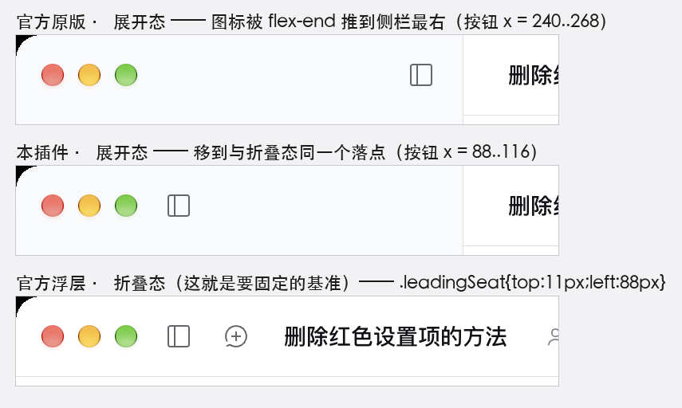
  </p>

  > 这张图是**真实窗口截图**（`screencapture -l`，2x），不是 DOM 副本 —— 三行分别是
  > 「关掉本规则」「开着本规则」「侧栏收起（基准）」，三态在同一台机器、同一次会话里连拍。
  > 逐帧验证：连拍 40 帧（约 90ms 一帧），期间状态来回切换了两次（展开 → 收起 → 展开），
  > 图标包围盒**恒为 x 190..217 / y 36..63@2x**（= CSS x 95..108.5 / y 18..31.5），
  > 过场帧与静止帧的像素个数也完全相同（244）—— 没有位移、没有闪烁。

  必须排除全屏（`html:not([data-fullscreen])`）：全屏下没有红绿灯，官方把浮层挪到
  `left:12px`、`topStrip` 也改成 `flex-start`，开关在**两态本来就都落在 x = 12..40**，
  不排除反而会被这条规则推到 88px。

  选择器用「sidebar 根容器的第一个子元素」定位 `topStrip`：它只在 `darwinDesktop` 下渲染，
  而 `isDarwinDesktop()` 就是读 `[data-platform="darwin"]`（同一个属性），两者同义，
  所以 Web 端永远不会命中这条（那里第一个子元素是品牌行）。

- **规则 2 — 新会话按钮：保留，但画成列表行**：「新会话」是外壳自己渲染的按钮
  （`SidebarRoot` 里 `sidebar` 根容器唯一的直接子 `<button>`），官方把它做成一张**独立卡片**：
  `38px` 高、`.5px` 描边、elevated 半透明底、**内容居中**、下外边距 `12px`；
  而紧挨着它的 `nav.panelList` 面板行是 `32px` **无底色胶囊**、图标与文字**左对齐**。
  品牌行（规则 1）去掉后两者上下相邻 —— 一张卡片压在一份列表上，看起来是两种东西。

  规则 2 把它改画成面板行的同款，实测（真实 Chrome，`tools/verify-new-session.mjs`）：

  | | 官方 `.newSession` | `.panelRow`（nav） | 本插件 |
  |---|---|---|---|
  | 高度 | 38px | 32px | **32px**（规则 9 统一） |
  | 左右外边距 | 14px（`margin: 0 2px` + 12px 内边距） | 8px | **8px** |
  | 到下一行的间距 | 12px | 4px | **4px** |
  | 描边 / 底色 | `.5px` 描边 + elevated 半透明底 | 无 / transparent | **无 / transparent** |
  | 内容对齐 | 居中（图标 109..123、文字 129） | 左对齐 | **左对齐** |
  | 图标 | 14px | 16px | **16px**（都落在 16px 垂线） |
  | 图标→文字 | 6px | 8px | **8px** |
  | 文字 x | 129px | 40px | **40px** |
  | 字重 | 500 | 400（继承根） | **400** |
  | hover | `--dsw-alias-button-floating-hover`（卡片更亮） | `--dsw-alias-interactive-bg-hover` | **列表行同款** |

  几个不显然的地方：

  1. **为什么下外边距是 4px**：它就是 `nav.panelList` 的行间距。设成 4px 后，「新会话」
     与面板行之间、面板行彼此之间的间距完全一样，读起来是**同一份列表**（否则会多出 8px
     的断口，又变回「一个按钮 + 一份列表」）。
  2. **为什么底色要用 `!important`**：官方在 macOS 上给这张卡片叠了四层底色
     （`[data-platform=darwin] .newSession` 亮/暗两态 + 各自的 hover），选择器都是
     2~4 层，普通规则压不过。作用域只有这一个按钮，而且展开态与收起态要的都是
     「无底色 + hover 用 `interactive-bg-hover`」，所以收起态不需要再写复位。
  3. **为什么内容对齐用 `:has(> span)` 守卫**：官方把内容做成
     `.newSessionContent{justify-content:center; width:100cqw}`，要改成左对齐就得改它；
     而**文字 span 只在宽态渲染**，于是 `button > span:first-child > span:has(> span)`
     恰好等于「这一列是展开的」。收起态的 56px 轨道（以及 Windows 的 36×36 圆形按钮）
     自动不命中，轨道里的图标仍然是官方值（18px、居中）—— 已由
     `tools/verify-new-session.mjs` 断言（`:has()` 守卫一旦失效，这条断言会红）。
  4. **⌘N 键帽保留**：官方的 `ShortcutKeys`（12px / `label-tertiary`）只在 hover 显示，
     静止态与列表行完全一样；宽态下 Tooltip 是关掉的，删掉它就再没有快捷键提示了。
  5. **`margin-left/right: 0` 与规则 3 同源**：面板行被规则 3 归零了 `margin: 0 2px`，
     两边的 pill 左边缘因此都落在规则 6 的 8px 内边距上。

  <p align="center">
    
  </p>

  > 上面那张是 DOM 副本（真实产物 CSS + 真实外壳 JSX）。下面这张是**真实窗口截图**
  > （`screencapture -l`，2x，亮色外观）。对它做像素扫描：五行的文字左边缘都在 2x 图的
  > 第 81/82 像素（= CSS 40.5/41px，多出的 0.5~1px 是字形自身的左留白），
  > 行间距也一律 40px —— 与面板行完全同一条线、同一个节奏。

  <p align="center">
    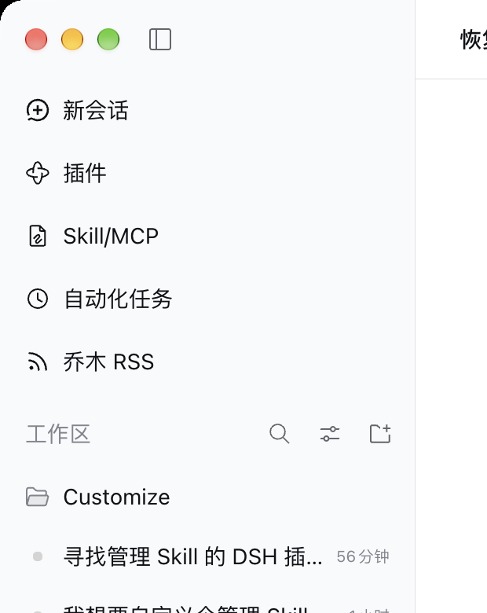
  </p>

- **规则 3 — 面板 pill 比列表 pill 多缩 2px**：官方给面板行写了 `margin: 0 2px`，
  而列表行没有。归零后两类 pill 的左右边距**相等**（绝对值由规则 5 决定），
  图标也随之内缩对齐。
- **规则 3/4/5 — 文字落在三条不同的线上**：面板行 `gap: 8px` → 46px、工作区行 `gap: 6px` → 42px、
  会话行 `margin-left: 4px` → 40px。三者统一到 **8px** 后，文字自然同线（40px）
  （规则 2 把「新会话」也一并拉上这条线 —— 它官方是**居中**的，没有自己的左对齐线）。
  会话行之所以单独用 `margin-left` 而不是 `gap`：给它加 `gap` 会把**标题与时间戳之间**也一起撑开。
- **规则 6 — 收紧整体内边距**：官方把 `--dsh-sidebar-inline-padding: 12px` 写在根元素**自己**身上，
  所以必须命中同一个元素才能覆盖（`[data-slot]` 属性的特异性高于单个 class）。
  它一处决定：
  - 列表行 pill 的左右外边距（12px → **8px**）
  - 面板行 pill 的左右外边距（同为 12px → **8px**）
  - 工作区的 `edge-inset` —— 也就是右侧「padding + `scrollbar-gutter` 预留 + margin」那套对称算法

  图标随之外移：20px → **16px**。

<p align="center">
  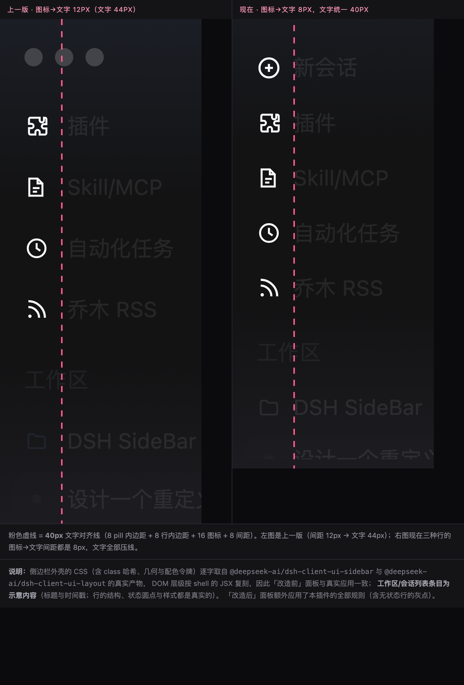
</p>

- **规则 7 — 「展开其余 N 个会话」按钮**：官方给的是高 28px、字号 12px、小圆角、hover 只变色不加底、
  文字起点 36px。这里把它拉齐成与会话行完全一致（`data-row-key="overflow:…"` 是它的稳定标记）。
  改文案要多绕一步：官方文案由 i18n 生成（`展开其余 {n} 个会话` / `收起`），而且
  **同一个按钮复用这两种状态**。做法是用 `font-size: 0` 隐藏官方文字（文本仍留在 DOM 里，
  屏幕阅读器依旧能读到计数），再用 `::after` 显示新文案，并以 `aria-expanded` 区分两态。
  选择器特意写成 `button[...]`：官方有一条同特异性的 `margin-top: 0`，靠声明顺序不可靠，
  加上元素选择器才能确定压过它。

<p align="center">
  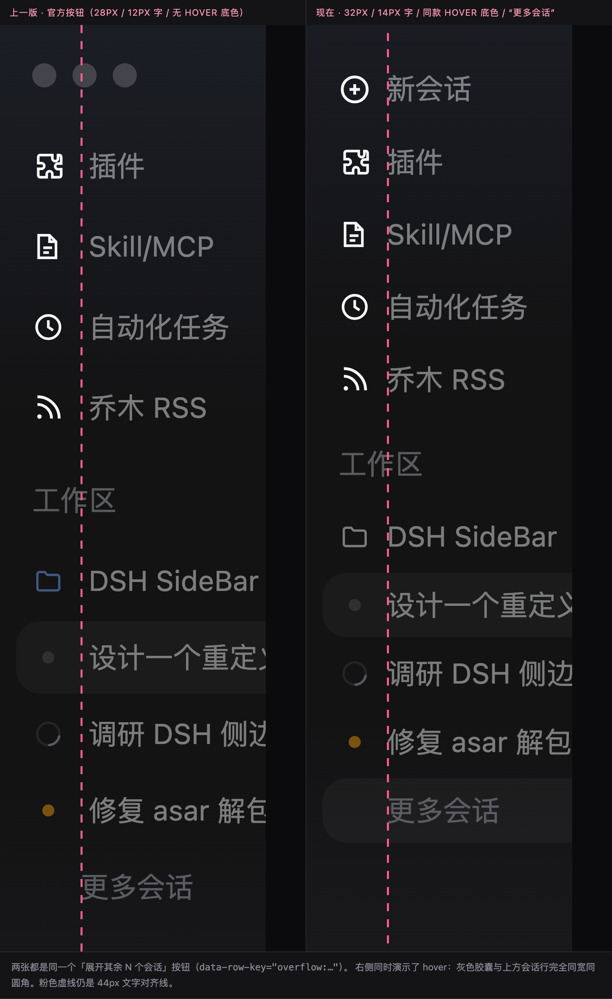
</p>

- **规则 8 — 「工作区」区段标题**：规则 6 把整体内边距收到 8px 后，标题落在 12px
  （= pill 8 + 标题行内边距 4），比下方图标（16px）靠左 4px。把标题行的 `padding-left` 提到 8px
  后，标题与所有图标回到同一条 **16px** 垂线。标题行没有专属标记，用「工作区区域根元素的第一个
  子元素」定位（展开/收起两态它都是标题行）；收起态官方把该行 `padding-left` 归零，故显式复位。

<p align="center">
  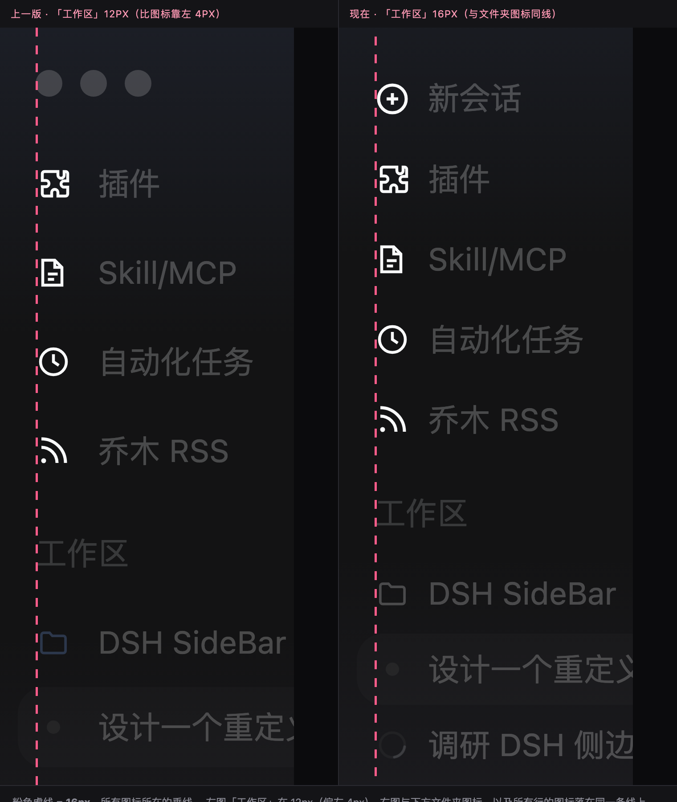
</p>

- **规则 9 — 行高统一**：官方四档不一（面板行 36 / 区段标题行 36 / 工作区行 34 / 会话行 32，
  「更多会话」按钮 28）。全部统一到 **32px**（= 官方会话行的原生高度），
  面板行与新会话行是靠 `min-height` + 上下内边距撑高的，所以同时把上下内边距从 7px 收到 5px。
  行内内容是垂直居中的，所以只有上下留白变化，图标与文字的基线不动
  （垂线总览里的 8 / 16 / 40 三条线不受影响）。
  真实 Chrome 的实测见 `tools/verify-heights.mjs`：官方 36/36/34/32/28 → 全部 32px，
  且横向对齐线（图标 16px、文字 40px）一字不动。

<p align="center">
  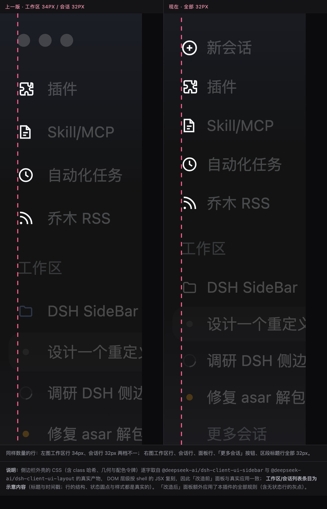
</p>

- **规则 12 — 去掉侧栏渐变**：官方在 macOS 下给侧栏列叠了**两层**：一层写死的
  `linear-gradient`（顶部 `#7a9bf0` 淡蓝、底部 `#8f89b8` 淡紫）+ 一层半透明基色。
  这里只去掉渐变那一层，并**逐态复刻**官方的基色算法，不透明度由规则 10 的两个旋钮决定
  （亮色 90%、暗色 50%、`prefers-reduced-transparency: reduce` 时 90%）。

  > ⚠️ 必须把 `prefers-reduced-transparency` 分支也显式写出来：本插件的普通规则特异性
  > 高于官方那条 media 规则，不显式复刻就会把「减少透明度」这个无障碍偏好顶掉。

  实测：去掉后 `linear-gradient` 层数 = 0，半透明层亮色 `rgba(251,252,255,.9)`、暗色 `rgba(21,21,23,.5)`。

<p align="center">
  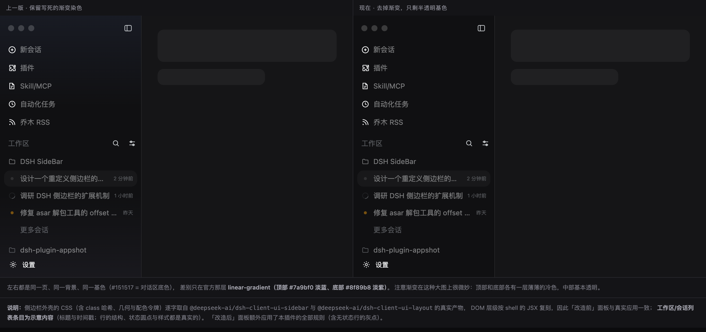
</p>

- **规则 11 — 激活工作区的文件夹图标**：官方 `.folderActive { color: var(--dsw-alias-state-business-primary) }`
  把「当前会话所在的工作区」的文件夹染成蓝色强调。改成 `color: inherit` 后与行文字同色。
  难点在于这个「激活」态**没有稳定属性标记**，只有 CSS Modules 的构建哈希类名。但哈希类名的形式是
  `<构建哈希>_folderActive` —— 前半段每次构建都变，后半段来自源文件的 key
  （已核对映射表：`"folderActive": "jJkEga_folderActive"`），跨版本稳定。所以用 `[class*=]`
  匹配后缀，比写死完整类名安全得多；万一上游重命名该 key，规则静默失效（只是变回蓝色）。

<p align="center">
  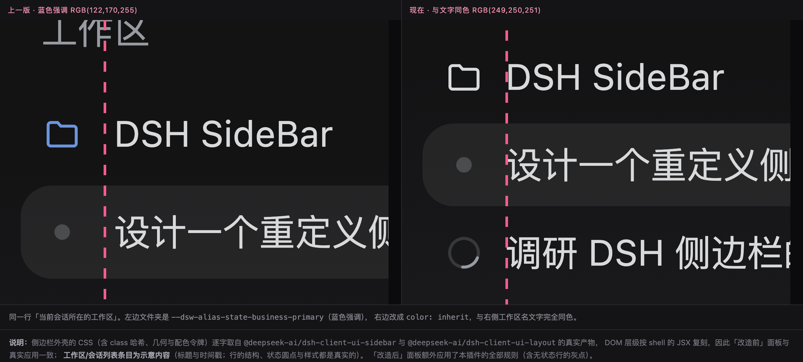
</p>

- **规则 13 — 无状态的会话行补一个灰点**：官方只为**有状态**的会话画圆点：`primary` 状态不是
  `idle` 时渲染 `StateDot`（`done` 绿 / `warning` 琥珀 / `error` 红，实心点都是 **10px 盒 + 6px 可见圆**；
  `ongoing` 是 14px 的转圈）。一旦落回 `idle`（不忙、没有待审批、没有子代理、没有完成提醒），
  槽位里就只剩 `sidebar.session.row.leading` 座位本身（默认空），于是行首什么都不画 ——
  同一列里只有一部分行有圆点，左侧这一列看起来是断的。

  这条规则给那个空座位补上官方 `idle` 状态色的同尺寸圆点：

  | | 官方 | 本插件 |
  |---|---|---|
  | 槽位内容 | `StateDot`（有状态）/ 空座位锚点（idle） | 同上 + idle 时画 6px 灰点 |
  | 可见直径 | 10px × (1 − 2×20%) = **6px** | **6px**（同心） |
  | 颜色 | `--dsw-alias-state-idle-primary`：亮 `#d4d4d4` / 暗 `#545557` | 同一个令牌 |

  三个关键点：

  1. **为什么用 CSS 而不是往座位里注册组件**：`sidebar.session.row.leading` 是 `kind: list` 的座位，
     官方留它给别的插件放「环境标记」（源码注释：*an ambient automation mark never appears beside
     the row's own state dot*）。注册进去会与那些标记并排出现两个东西。纯 CSS 的最坏结果只是
     「规则不再命中、圆点消失」，回到官方行为。
  2. **为什么 `:has(> …:empty)` 恰好等于「idle」**：渲染器的座位锚点
     `div[data-slot="sidebar.session.row.leading"]` 只在
     `!archived && !blank && primary === idle` 这一支里渲染；`StateDot` 与它互斥。所以
     「锚点存在」本身就是 idle 的稳定标记，再用 `:empty` 确认没有被别的插件占用。
     归档行与「新会话」占位行根本不渲染锚点，官方要求它们保持空白 —— 本规则不改变这一点。
  3. **为什么是 6px 而不是 10px**：槽位的彩色点不是 10px 的实心圆，而是 10px 的盒子 +
     `::after{inset:20%}` 画出来的 6px 圆（`StateDot.module.css`）。槽位自身是
     `inline-flex` + `center/center`，6px 与 10px 的盒子同心，所以直接画 6px 的圆，
     直径与圆心都与彩色点重合。

<p align="center">
  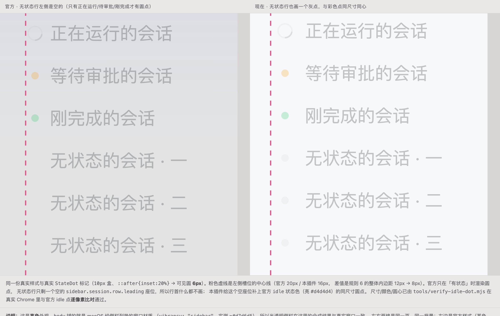
</p>

  这张图用的是**真实产物 CSS + 真实的 `StateDot` 标记**（预览页 `preview/idle-dot.html`，亮色 3× 放大，
  本地由 `tools/build-preview.mjs` 生成）：
  左边官方只有「正在运行 / 等待审批 / 刚完成」三行有圆点，三行无状态的会话是空的；
  右边本插件把三个空座位补成灰点。橙点、绿点、灰点直径完全相同，圆心同在槽位中心线上
  （粉色虚线；左右两侧的 x 差 4px 是规则 6 把整体内边距从 12px 收到 8px 的结果）。

  除了肉眼对照，`tools/verify-idle-dot.mjs` 在真实 Chrome 里把「官方 idle 点」与「本插件画的灰点」
  的**槽位截图逐像素比对**（亮/暗两态、`max channel diff = 0`），并用负例守住边界：
  座位被别人占用、归档行、新会话占位行都不画，已有绿点的行不受影响。

- **规则 15 — 工作区与工作区之间：4px → 8px**：列表里每个工作区是一个 `groupSection`
  （工作区行 + 它的会话行），官方只用两条 margin 表达层级：

  | 位置 | 官方 | 现在 |
  |---|---|---|
  | 组内相邻行（`.groupSection > * + *`） | 2px | 2px（未动） |
  | 「更多会话」按钮（官方单独归零） | 0px | **2px**（规则 7 拉齐成普通行距） |
  | **工作区与工作区之间**（`.groupSection + .groupSection`） | **4px** | **8px** |
  | 区段标题行 → 第一个工作区行 | 4px | 4px（未动） |

  4px 只比组内行距大一倍，分组几乎读不出来；提到 8px（= 组内行距的 4 倍）后
  「换了一个工作区」才有明确的呼吸感。配合规则 9 的 32px 行高，现在的纵向节奏是：
  **组内相邻两行 34px（32+2）、跨工作区 40px（32+8）**。

  选择器只能用后缀匹配：`_7514NG_groupSection` 是 CSS Modules 哈希，用
  `[class*="groupSection"]` 匹配稳定后缀（与规则 11 的 `folderActive` 同一套路）。
  它带三个属性段，特异性高于官方那条两类的规则，所以不需要 `!important`；
  上游若重命名这个 key，规则静默失效（回到 4px），不会波及其它东西。

  实测（真实 Chrome + 真实产物 CSS，`tools/verify-heights.mjs`）：跨组 4px → **8px**，
  组内仍是 2px、「更多会话」按钮 2px、标题行 → 首组 4px，全部逐项断言。
  真机截图交叉验证：跨组两行的行顶距 40.5 CSS px（= 32 + 8），组内相邻灰点 34 CSS px。

- **规则 10 — 侧边栏底色**：底色**不是外壳画的**，而是布局的侧栏列画的，macOS 下还是两层叠加：

  | 层 | 内容 |
  |---|---|
  | 顶层 | `linear-gradient(#7a9bf0…, #8f89b8…)` —— 顶部淡蓝、底部淡紫的染色（写死在布局里，规则 12 去掉） |
  | 底层 | `color-mix(in srgb, <基色> <不透明度>, transparent)` —— 半透明，透出窗口毛玻璃 |

  基色 = `--dsw-specific-sidebar-fill`（暗 `#1b1b1c` / 亮 `#f9fafb`，来自主题的
  `--dsw-static-neutral-bluish-900` / `-50`）。非 macOS 下这一列是**纯色**；外壳
  `_3WPZCG_root` 虽然也用它，但 `[data-platform=darwin]` 下被置为 `0 0`（不画）。

  规则 10 把**基色与不透明度**都显式化成变量，一态两个旋钮：

  | 旋钮 | 官方值 | 现在 | 依据 |
  |---|---|---|---|
  | `--dsh-sidebar-fill-dark` | `#1b1b1c`（bluish-900） | **`#151517`**（bluish-950） | = 中栏对话区 `--dsw-alias-bg-base` |
  | `--dsh-sidebar-alpha-dark` | 50% | 50%（未动） | 保持官方玻璃感 |
  | `--dsh-sidebar-fill-light` | `#f9fafb`（bluish-50） | **`#ffffff`**（bluish-00） | = 中栏对话区 `--dsw-alias-bg-base` |
  | `--dsh-sidebar-alpha-light` | 40% | **90%** | 见下（单换基色不够） |

  实测（macOS 窗口，亮色）：官方侧栏 `rgb(227,227,228)`、对话区 `rgb(255,255,255)`。
  **只把亮色基色换成 `#ffffff` 只走到 `rgb(229,227,228)`** —— 肉眼无法分辨：
  侧栏只剩 40% 不透明，其余 60% 是 macOS 的窗口材质（`vibrancy: "sidebar"`，实测 ≈`rgb(215,214,213)`），
  基色的权重太小。把不透明度一并提到 **90%** 后落到 `rgb(248,248,250)`，与对话区只差 7 级。

  暗色那套完全没动（基色 `#151517` + 50%），与对话区 `rgb(21,21,23)` 的关系维持原样。
  作用域用 `div:has(> [data-slot="sidebar"])` 锁在侧栏列（座位锚点是它的直接子元素），
  避免影响同样使用该 token 的其它界面。

  > ⚠️ 侧栏始终是半透明的，最终观感 = 不透明度 × 基色 +（1 − 不透明度）× 窗口材质，
  > 所以它不会与不透明的对话区**完全相等**；亮色 90% 之后剩下的差值主要来自窗口材质。
  > 想让两者完全一致，把 `--dsh-sidebar-alpha-light` 设成 `100%` 即可。

<p align="center">
  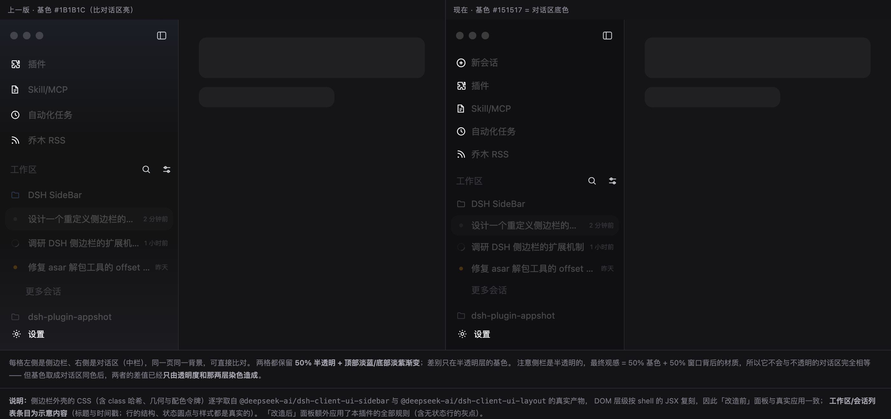
</p>

<p align="center">
  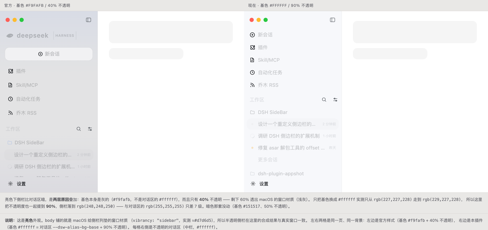
</p>

> 亮色预览页 `preview/fill-light.html`（本地由 `tools/build-preview.mjs` 生成）的 `body` 铺的就是上面那个窗口材质
> （实测色 `#d7d6d5`），所以页面里的合成结果与真实窗口一致：左格官方 = 渐变 + 40% 基色，
> 右格 = 90% `#ffffff`、无渐变；两格右侧的对话区都是不透明的 `#ffffff`。

- **规则 14 — 设置行右侧的设置入口（真实按钮，自己的热区）**：`sidebar.settings` 座位渲染的
  第一行（`.triggerRow`）左边是头像 + 名字，整行是一个按钮：有账号插件时它是**账号菜单**的
  触发者（`AccountMenu`），没有时是官方那个**直接打开设置**的回退按钮。

  官方在这行的右侧留白。需求是「在这里放一个**直接进设置页**的入口，而且**热区和头像区分开**」，
  这两件事伪元素都做不到（伪元素只能继承所在按钮的行为，点它等于点整行）——所以规则 14 是本插件
  唯一的真实组件：一个 `<button class="dsh-settings-entry">`，注册进外壳的
  `sidebar.footer.action` 座位（`kind: list`，渲染在 `.footerActions` 里），再由 CSS 排到设置行右端。

  ```
  data-slot="sidebar"
   └─ ._3WPZCG_root
       └─ ._3WPZCG_footArea            ← 规则 14 把它从「竖排两行」改成「一行两列」
           ├─ ._3WPZCG_footerActions   ← grid-area 1/2
           │   └─ [data-slot="sidebar.footer.action"] → <button class="dsh-settings-entry">
           └─ ._3WPZCG_settingsArea    ← grid-area 1/1
               └─ [data-slot="sidebar.settings"] → .triggerRow（头像 + 王道裕，账号菜单）
  ```

  | | 「新建工作区」`._7514NG_iconButton` | 本插件（规则 14） |
  |---|---|---|
  | 盒子 | 28×28 | **28×28，实测 x/右缘与它逐像素相同** |
  | 圆角 / 颜色 | `--dsw-radius-sm` / `label-secondary` | 同一个令牌 |
  | hover | `--dsw-alias-interactive-bg-hover` | 同一个令牌 |
  | 落点 | 列宽 − 8px（28px 盒的右缘） | **列宽 − 8px（同一个盒子）** |
  | 行为 | 新建工作区 | **直接打开设置面板**（`settings.open`） |

  几个要点：

  1. **两个热区真的分开了**：脚区由竖排两行变成一行两列后，账号行不再延伸到齿轮底下
     （实测账号行右缘 242、齿轮左缘 244，留 2px 间隙），所以 hover 各自只亮自己的胶囊，
     点齿轮不会弹账号菜单。两列同一行 + `align-items: center`，纵向自动对齐 ——
     官方那行是 44px 还是 32px（未登录）都不用改任何数。
  2. **点击走官方命令，不碰内部状态**：`ui-settings-general` 在它的 `sidebar.settings` 注入里
     注册了 `settings.open` 命令（⌘, 绑的就是它）。

     ⚠️ 这里有个坑：**命令的「跑一次」入口不在服务上，在服务持有的注册表上**。
     `ctx.shortcuts`（`ShortcutsService`）的公开面只有
     `register / registerFixed / describeBinding / edit / observeFixedInput / fixedInput`，
     `invoke(id, context)` 是它内部那个 `ShortcutRegistry` 的方法 —— 原生菜单点击就是走
     `registry.invoke(commandId, context)`。所以本插件用 `ctx.shortcuts.registry.invoke(...)`
     跑命令；一开始写成 `ctx.shortcuts.invoke(...)` 时点击**静默无效**（TypeError 被 React
     吞在事件里），实测真实窗口才定位到。

     ```js
     ctx.shortcuts.registry.invoke('settings.open', { modal: null, region: 'page' });
     ```

     `context` 与 DOM / 原生那两个处理器构造的一致：`modal: null` = 当前没有模态框、
     `region: 'page'` = 焦点不在终端/输入框。`modal: null` 时命令自己的 `resolve` 会执行
     `…actions.open()`，与按 ⌘, 完全一样。命令将来若改名，点击变成无操作，不会报错，
     也不会去动设置面板的内部状态（`registry` 取不到时同样直接返回）。
  3. **齿轮形状仍是官方 `IconSettingsOutlineMedium` 的同一份 path**（`viewBox 0 0 16 16`、
     `stroke-width 1.3`），做成 `mask` 画在按钮的 `::after` 上（`inset: 6px` → 16px），
     按钮自己的底色留给 hover 胶囊，两套主题都不脱节。
  4. **收起态显式复位**：Web/Windows 的 36px 轨道里没有位置放它（轨道里的账号行本身就是设置
     符号），脚区也复位成官方的竖排。复位规则要写全 `div:has(> [data-slot="sidebar"])`，
     否则特异性比展开态那几条低一级、压不住 —— 这两点由 `tools/verify-settings-entry.mjs`
     的收起态断言守住。
  5. **这是插件里唯一的 JS**：其余 13 条全是样式表，卸载样式表即恢复官方外观；这一条注册在
     `ctx.slots.inject` 里，插件卸载时自动摘除（`apply` 里的注册由框架托管）。

  <p align="center">
    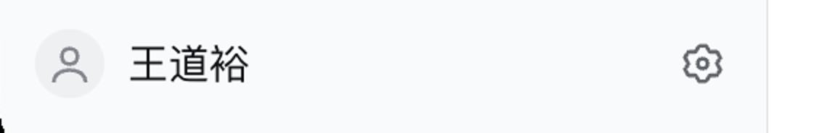
  </p>

- `[data-slot="KEY"]` 是渲染器给**每一个**槽位输出的锚点 div（`display:contents`），由框架保证。
- `data-window-drag` 是外壳自己打的窗口拖拽标记。
- `nav` 是面板列表容器（`sidebar.panellist` 的宿主），它的直接子元素就是各面板行 —— 这样能绕开哈希类名。
- `[data-row-key^="workspace:"]` 是工作区行的稳定标记；**只用属性选择器，不碰哈希类名**。
- 规则 1 特意键控在 `sidebar.brand.name` 上：**这个槽只在展开态渲染**。
  于是收起成 56px 轨道时规则自动失效，**轨道里的展开按钮得以保留**（否则 Web 端会把自己锁死在收起状态）。这是本插件唯一一处不显然但很重要的设计。

选择器已用「还原外壳 JSX 的 DOM 副本」在 5 种状态组合下断言通过：
web/darwin × 展开/收起 × 有/无全局面板。

## 依赖

- `:has()`（Chrome 105+ / Safari 15.4+）。当前 Electron 与浏览器都满足；
  万一缺失，规则 1 静默失效（品牌行回来），不会报错。

### 生效时机

| 改动 | 生效方式 |
|---|---|
| `client.js` 里的 CSS | `dsh-client-hmr` 每 500ms 轮询构建产物 → **约 0.5s 自动热替换，无需刷新** |
| `cordis.patch.yml` | 实时（`dsh-hmr` 监听 patch 文件） |
| 首次安装 / 从 bundles 移除 | **需要重启 App** |

### 自检（可复现）

```bash
cd <本仓库根目录>          # tools/ 与 preview/ 所在处
NODE="$(command -v node || echo '/Applications/DeepSeek Harness.app/Contents/Resources/runtime/primary-runtime/dependencies/node/bin/node')"

# 0) 前置：本仓库只分发**截图**，不含任何官方产物片段（core/、preview/*.css、preview/*.html
#    都在 .gitignore 里）。真引擎断言要的夹具全部从本机 DSH 现场抽出来：
"$NODE" tools/asar-extract.cjs ./core \
  /dsh/node_modules/@deepseek-ai/dsh-client-ui-primitives/ \
  /dsh/node_modules/@deepseek-ai/dsh-client-ui-theme/ \
  /dsh/node_modules/@deepseek-ai/dsh-client-ui-layout/ \
  /dsh/node_modules/@deepseek-ai/dsh-client-ui-sidebar/ \
  /dsh/node_modules/@deepseek-ai/dsh-client-ui-workspace/
T=core/dsh/node_modules/@deepseek-ai
"$NODE" tools/extract-css.mjs $T/dsh-client-ui-theme/lib/client.js     preview/theme.css
"$NODE" tools/extract-css.mjs $T/dsh-client-ui-layout/lib/client.js    preview/layout.css
"$NODE" tools/extract-css.mjs $T/dsh-client-ui-sidebar/lib/client.js   preview/shell.css
"$NODE" tools/extract-css.mjs $T/dsh-client-ui-workspace/lib/client.js preview/workspace.css --min 50
"$NODE" tools/extract-css.mjs $T/dsh-client-ui-theme/lib/client.js     preview/palette.css --only design_platform_css_default
#    这五个文件与上游夹具逐字节一致；夹具齐了之后 build-preview.mjs 会生成 preview/*.html。

# 1) 离线单测：注册、注入、选择器、旋钮、卸载与热重载不堆叠（唯一不需要夹具的一步）
"$NODE" tools/test-plugin.mjs

# 2) 真引擎级联校验（headless Chrome）：两态各自的基色/不透明度/渐变是否被覆盖
"$NODE" tools/verify-fill.mjs

# 3) 真引擎落点校验（headless Chrome）：展开态与折叠态是否真的落在同一格
"$NODE" tools/verify-toggle.mjs

# 4) 真引擎圆点校验（headless Chrome + Pillow）：灰点与官方 idle 点逐像素一致 + 负例
"$NODE" tools/verify-idle-dot.mjs

# 5) 真引擎行样式校验（headless Chrome）：新会话行的盒子与 .panelRow 逐项相同，
#    并守住收起态（36×36 居中 18px 图标）不受影响
"$NODE" tools/verify-new-session.mjs

# 6) 真引擎行高校验（headless Chrome）：官方 36/36/34/32/28 → 全部 32px，
#    横向对齐线（图标 16px / 文字 40px）不动，56px 轨道仍是 36×36
"$NODE" tools/verify-heights.mjs

# 7) 真引擎设置入口校验（headless Chrome）：齿轮的盒子/颜色/遮罩，以及
#    「与新建工作区按钮同一条垂线」；设置行的两份样式表直接从 app.asar 里读
"$NODE" tools/verify-settings-entry.mjs
```

`verify-fill.mjs` 用的是 `preview/` 里那套**真实产物 CSS** + 真实 DOM 形状，断言的是计算值
（例如亮色 `color(srgb 0.984 0.988 0.998 / 0.9)`、暗色 `color(srgb 0.082 0.082 0.090 / 0.5)`，
且两态的 `background-image` 都是 `none`），所以它同时守住「亮色改成什么样」和「暗色没被动」。

`verify-toggle.mjs` 同样用真实产物 CSS，但把两个宿主**同时**摆进页面量盒子，断言的核心是
「展开态按钮与折叠态按钮的 `x/y` 相等（均为 88 / 11，28×28）」。这条断言不写死 88 ——
它比的是两个宿主谁也别离开谁，所以上游挪动 `.leadingSeat` 时它会红，而不是悄悄失效。
另外三种状态各有一组断言：全屏（本规则不生效、两态本来就都在 12px）、Web（不生效、仍贴最右）、
以及「品牌行的左内边距仍为官方的 4px」（证明没打偏）。

`verify-new-session.mjs` 同样加载本插件 `client.js` 里的真实样式表 + 真实外壳 CSS，
把「新会话按钮」与「面板行」放在同一页里量盒子：高度、左右边距、下边距、图标 x/尺寸、
文字 x、字重、圆角、底色逐项相等 —— 并且在同一个页面里把插件样式摘掉再量一次，
证明官方那张 38px elevated 卡片确实被压掉了。收起态另有一组断言：一旦 `:has(> span)`
守卫失效、行样式漏进 56px 轨道，它会立刻变红。

`verify-heights.mjs` 用同样的方式量「每一行多高」：先在没有插件的对照列里确认官方原值
（面板 36 / 标题行 36 / 工作区 34 / 会话 32 / 更多会话 28），再带上插件量一遍
（五者全部 32px、会话行行距 32 + 2 间隙 = 34px），并断言横向那两条线
（图标 16px、文字 40px）与改动前一模一样 —— 行高只吃纵向留白。轨道单独一组：
官方轨道规则特异性更高，所以 56px 轨道里的方形按钮仍是 36×36、图标仍居中。

`verify-idle-dot.mjs` 用同一套真实产物 CSS 加官方 `StateDot.module.css`，把「官方 idle 点」与
「插件给空座位画的灰点」放在同一页的同一槽位里，然后**截图逐像素比对**（亮/暗两态，
全部为 `max channel diff = 0`；可见直径 6px、圆心相同、颜色 = 官方 `--dsw-alias-state-idle-primary`）。
它同时断言规则**不该**生效的三种行：座位被别的插件占用、归档行、新会话占位行
（后两类官方根本不渲染座位锚点），以及已有绿点的行不受影响。

底色/对齐这类需要肉眼看的效果，用 `preview/` 里的对照页：

```bash
"$NODE" tools/build-preview.mjs          # 重新生成预览 HTML
"$NODE" tools/screenshot-preview.mjs     # 用 headless Chrome 把每个页面渲染成 preview/*.png
"$NODE" tools/screenshot-preview.mjs idle-dot   # 只渲染某一页
```

## 已知取舍

- **macOS 的窗口拖拽区**：品牌行原本也是一块 `data-window-drag` 拖拽区。隐藏后侧边栏顶部仍保留 52px 的 `topStrip`（红绿灯那一条，内含折叠按钮）作为拖拽区，所以窗口依然可从侧边栏拖动。
- **Web 端的折叠按钮**：Web 端没有 `topStrip`，折叠按钮就在品牌行里。规则 1 因此只在展开态生效 —— 收起后品牌行会回来（就是那个鲸鱼图标），它此刻的角色是**展开按钮**。若你希望收起态也完全空白，需要再额外提供一个展开入口（可以注册到 `sidebar.footer.action` 座位）。
- **只改外观**：本插件不动行为。若要改交互（比如换掉整个会话列表、加入自定义视图），需要走槽位/座位那条路。
- **规则 2b 的 88px 是一个写死的数**：它必须等于官方浮层 `HeaderLeadingControls` 的宿主
  `.leadingSeat{left:88px}` —— 那个位置就是「折叠后的开关位置」，也是本规则的基准。
  CSS 读不到另一个元素的坐标，只能抄这个常量（已收成一个旋钮 `--dsh-sidebar-toggle-left`）。
  上游若挪动浮层，本规则**静默失效**（开关变回展开态在右、收起态在左），不会报错；
  同步改这一个旋钮即可。另外它是 `position:absolute` 相对 frame 定位，与侧栏列同一起点，
  所以 88px 又是「窗口左边到按钮左边缘」的距离 —— 展开态 `topStrip` 的负外边距正好抵消侧栏
  根容器的左内边距，两者同坐标系，这也是这条规则成立的前提。
- **规则 2b 只管图标，不管旁边的「+」**：折叠态浮层里其实有两个控件（面板图标 + 新建会话）；
  展开态那个入口由侧栏自己的「新会话」行承担。本规则只搬图标，所以两态切换时图标不动、
  「+」随官方逻辑显隐。
- **「新会话」行会把下面的列表整体下推 36px**（32px 行 + 4px 行距）：这是把按钮加回来的代价，
  也正是官方原本就有的高度开销 —— 规则 2 只是把它从 50px（38 + 12）收到 36px
  （行高本身由规则 9 统一到 32px）。
- **「新会话」行没有独立的分隔**：它与面板行同款、间距相同，所以读起来是同一份列表的第一行。
  若想让它看起来更像「另一个动作」，把规则 2 的 `margin: 0 0 4px` 调大即可（唯一旋钮）。
- **⌘N 键帽只在 hover 出现**：官方 `ShortcutKeys` 是 12px `label-tertiary` 的纯文字，
  静止态不可见 —— 所以静止态与面板行完全一致；想彻底去掉它，加一条
  `[data-slot="sidebar"] > div > button > span:last-child { display: none }`。

## 目录

```
package.json        插件清单（dsh.bundle.patch + dsh.client.platform）
cordis.patch.yml    把自己 mount 进插件树的唯一一行
index.js            宿主半边（本插件纯前端，空的）
client.js           浏览器半边：注册并注入整张样式表（零构建，手写 loader 信封）
README.md           本文档
```

---

## 附：工作区列表区域的间距规格（实测）

> 用真实产物 CSS 渲染后用 Chrome 量出来的（见 `tools/build-preview.mjs` 的 `measure.html`）。
> 下表是**本插件生效后**的数值；「官方」一列给出对照。列宽按 280px 计。

### 横向

```
列宽 280px
├ 8px ──────────────────────────────────────────────── 8px ┤   ← 行的左右外边距
│                                                          │
│  ┌── 行 pill（宽 264px，圆角 12px）────────────────────┐  │
│  │ 8px │ 图标 16px │ 8px │ 标题 │…│ 时间 │ 8px │  │  │
│  └────────────────────────────────────────────────────┘  │
└──────────────────────────────────────────────────────────┘
```

| 位置 | 官方 | 现在 |
|---|---|---|
| 行 pill 左外边距 | 12px | **8px** |
| 行 pill 右外边距 | 12px | **8px**（= padding-right 1px + `scrollbar-gutter` 预留 5px + margin 2px） |
| 行 pill 宽度 | 256px | **264px**（280 − 8 − 8） |
| 行 pill 圆角 | 12px（`--dsw-radius-md`） | 同 |
| 行内左内边距 | 8px + `--dsh-workspace-indent`（每层 +12px） | 同 |
| 全局面板行 pill 左右 | 14px | **8px**（与列表 pill 相等） |
| 图标 x（三种行） | 面板 22 / 工作区 20 / 会话 20 | **16px**（三者一致） |
| 图标→文字间距 | 8 / 6 / 4px | **8px**（三者一致） |
| 文字 x（三种行） | 46 / 42 / 40 | **40px**（三者一致） |
| 会话时间右边缘 | 距 pill 右边缘 8px | 4px |
| “工作区”区段标题 x | 16px | **16px**（与图标同线） |
| 滚动条 | 宽 5px，`scrollbar-gutter: stable`（始终占位，不引起行位移） | 同 |

### 左侧的垂线总览（实测）

```
 8px  ← 所有 pill 的左边缘（会话行 / 工作区行 / 更多会话按钮）
16px  ← 所有图标（含新会话）+ 「工作区」区段标题
40px  ← 所有文字（新会话 / 面板行 / 工作区行 / 会话行 / 更多会话按钮）
```

### 图标与文字的对齐线（实测，已统一）

**图标**全部在 16px、**文字**全部在 **40px**：

| 行类型 | 图标 | 文字 x（官方 → 现在） | 图标→文字（官方 → 现在） |
|---|---|---|---|
| 新会话（规则 2） | 14→16px | 居中(129px) → **40px** ✅ | 6px → **8px** |
| 面板行（插件 / Skill-MCP / 自动化任务 / 乔木 RSS） | 22→16px | 46px → **40px** ✅ | 8px → **8px** |
| 工作区行（DSH UI Lab / Pico / …） | 20→16px | 42px → **40px** ✅ | 6px → **8px** |
| 会话行 | 20→16px | 40px → **40px** ✅ | 4px → **8px** |
| 「更多会话」按钮 | 16px | 36px → **40px** ✅ | — |

> 三处的**字号**本来就都是 14px（面板行继承根的 `font-size:14px`，工作区/会话行的 `title` 也是 14px），
> 时间戳是 10px —— 这里统一的是**左对齐线**，不是字号。

### 纵向

| 元素 | 高度 | 与上一项的间距 |
|---|---|---|
| 新会话行（面板行同款） | 32px | 顶部 0 / 下方 4px |
| 面板行（插件 / Skill-MCP / …） | 32px | 4px |
| 区段标题行（工作区 + 搜索 + 视图选项） | 32px | 顶部 2px |
| → 第一条工作区行 | — | 4px |
| 工作区行 | **32px** | — |
| 会话行 | **32px** | **2px** |
| 组与组之间（跨工作区） | — | **8px** |
| 列表底部内边距 | 16px | — |

所有数值的完整来源见 [调研报告 §4](dsh-sidebar-recon.md)。要调整的话，最省事的旋钮是：

```css
/* 外层左右缩进（同时决定行 pill 边距与滚动条预留算法）。
   注意要命中根元素本身 —— 官方把变量写在它自己身上，写在祖先上会被它自己覆盖。 */
[data-slot="sidebar"] > div { --dsh-sidebar-inline-padding: 8px; }
/* 行间距 / 组间距 / 行高 —— 需要按座位锚点覆盖工作区自己的样式 */
```
